<p align="center">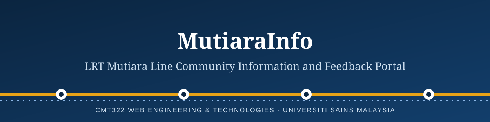</p>

<p align="center">
<em>Keeping Penang informed, one road closure at a time.</em><br><br>


</p>

---

## About the project

Building a railway through a living city asks a great deal of the people who live and work beside it. Roads close, pavements move, shop entrances shift, and the schedule changes from one week to the next. Residents need to know what is happening, and they need a dependable way to say when something goes wrong.

**MutiaraInfo**, the community portal for the LRT Mutiara Line, answers both needs. It is a web platform where project teams and government bodies publish construction news, where residents and business owners see what is affected on a map, and where every concern becomes a numbered ticket that can be followed until it is resolved.

This repository holds a **front-end simulation** built for the group project of *CMT322 Web Engineering & Technologies* (2026/2027, Semester 1), Universiti Sains Malaysia. It runs entirely in the browser with sample data. No server or database is needed.

## Who it serves

| Stakeholder | What they need from the portal |
| --- | --- |
| **Residents** | Clear notices on closures and schedules, and a simple way to raise concerns |
| **Business owners** | Information on how customers and deliveries can reach their premises |
| **Government bodies** | A view of public concerns and a way to review and respond |
| **Construction teams** | A channel to post updates and act on assigned tickets |

## Screenshots

<p align="center">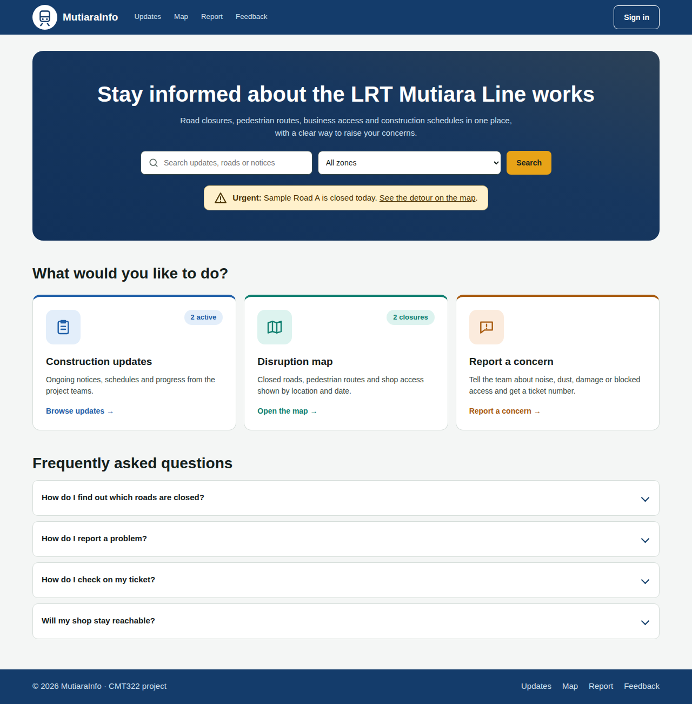<br><sub><b>Home.</b> A gradient banner, search with zone filter, three information cards and common questions.</sub></p>

<table>
<tr>
<td width="50%">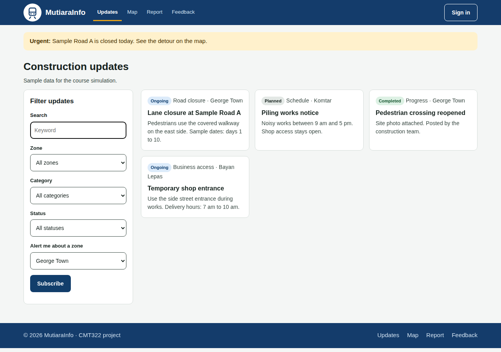<br><sub><b>Construction updates.</b> Notices with status labels and filters.</sub></td>
<td width="50%">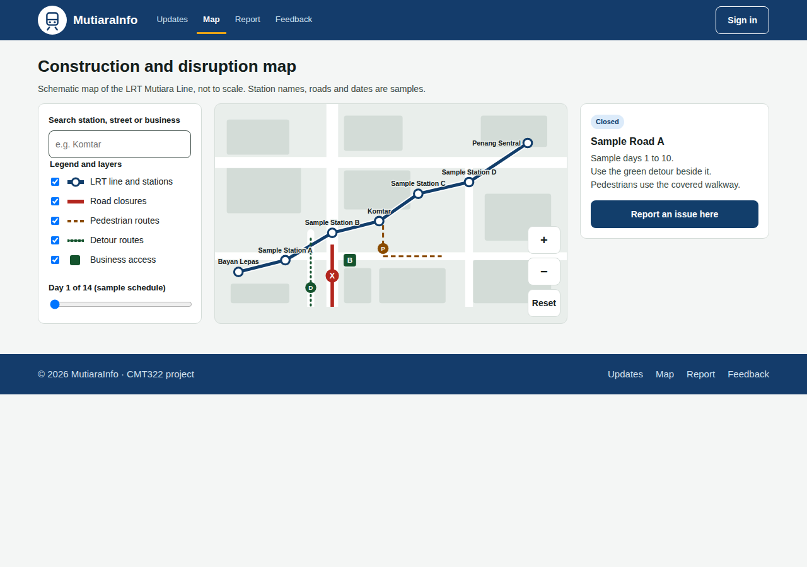<br><sub><b>Disruption map.</b> A route map with stations, a legend with layers, zoom and pan, and marker details.</sub></td>
</tr>
<tr>
<td width="50%">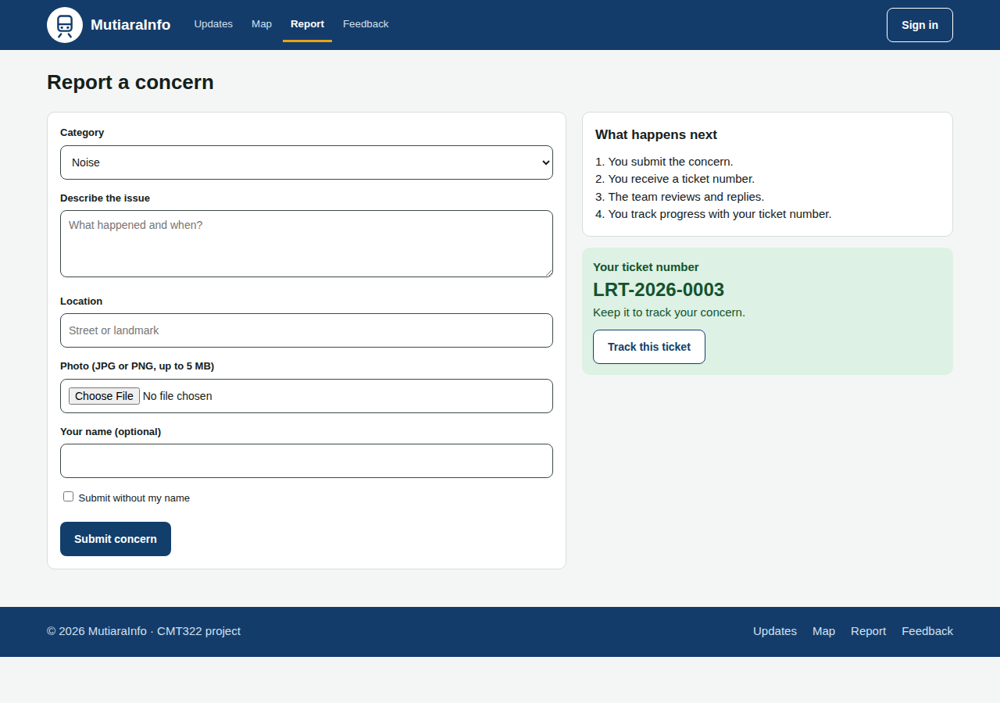<br><sub><b>Report a concern.</b> A short form that returns a ticket number.</sub></td>
<td width="50%">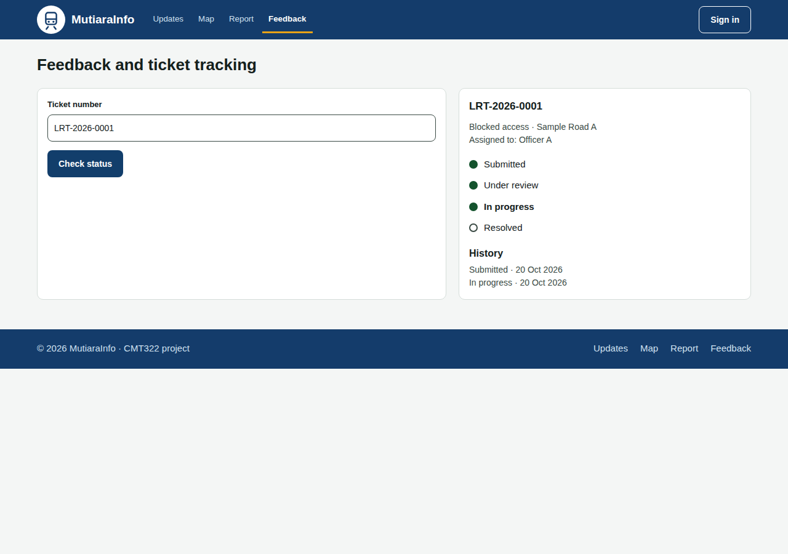<br><sub><b>Feedback and ticket tracking.</b> Status steps and history.</sub></td>
</tr>
<tr>
<td colspan="2">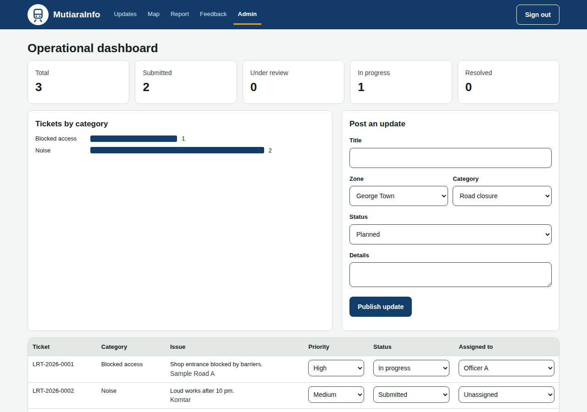<br><sub><b>Admin dashboard.</b> Ticket counts, a category chart and ticket management.</sub></td>
</tr>
</table>

## The four modules

| Module | Purpose | Main features |
| --- | --- | --- |
| **1. Construction Information Hub** | Share timely and reliable news | Posting updates, status labels, filters by zone, category and status, zone alerts |
| **2. Interactive Construction & Disruption Map** | Show what is affected, and where | Route map with stations, legend layers, zoom and pan, date slider, search, marker details, report from the map |
| **3. Community Feedback & Complaint** | Give residents a voice | Category form, photo check, ticket number, ticket tracking |
| **4. Admin & Feedback Tracking** | Turn concerns into action | Priority, assignment and status control, operational dashboard |

## How the modules connect

Each module uses the result of the one before it. Updates feed the map, the map leads into the complaint form, and complaints arrive on the admin dashboard.

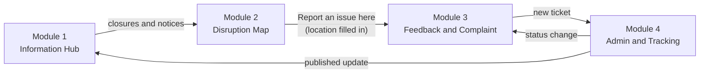

## A ticket's journey

A resident reports a concern and receives a ticket number. Staff then move the ticket through four stages, and the resident can check the current stage at any time.

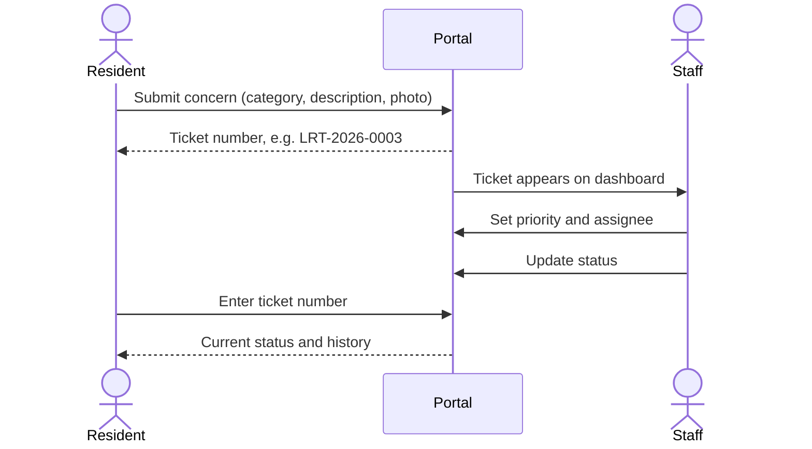

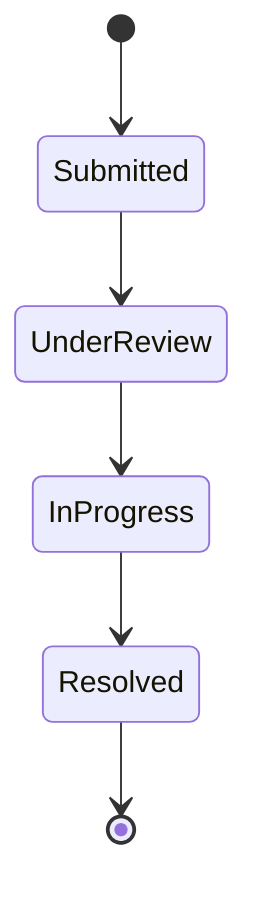

## How it is built

The portal is a single-page app written in plain HTML, CSS and JavaScript, with no framework and no build step. `index.html` is the shell (header, footer and an empty `<main>`). Each page lives in its own file under `pages/` with its own script under `js/pages/`, and `js/app.js` loads them all into the shell.

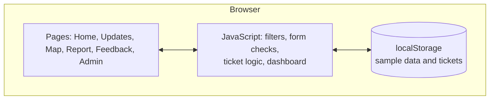

Tickets and updates are kept in the browser's `localStorage`, so changes survive a page refresh on the same device. They are not shared between users. Moving to a real deployment would mean replacing this storage with a server and database.

### Web engineering principles applied

- **Accessibility:** labelled form fields, keyboard-operable map markers, visible focus and sufficient colour contrast
- **Responsive design:** layouts that stack on narrow screens
- **Light and dark themes:** colours follow the visitor's system setting
- **Input validation:** required fields and photo type and size checks before a ticket is created
- **Separation of concerns:** structure (`pages/`), style (`css/`) and behaviour (`js/`) kept in separate files, one per page

## Try it

Open the live site: `https://<your-username>.github.io/CMT322-Assignment1-lrt-mutiara-portal/`

Or run it locally. Download the repository, open the folder in VS Code and use **Open with Live Server** on `index.html`. Opening the file by double-click will not work, because the pages are loaded with JavaScript modules.

**A suggested walkthrough**

1. On **Home**, search for a notice or open one of the three cards, then read the questions at the bottom.
2. On **Updates**, filter by zone and status.
3. On **Map**, move the date slider, select a closed road and press *Report an issue here*.
4. Submit the form and note the ticket number.
5. Open **Feedback** and enter that number.
6. Press **Sign in**, change the ticket's status, then check **Feedback** again.

## Repository structure

```text
.
├── index.html          app shell: header, footer, empty <main>
├── css/style.css       all styles
├── pages/              one HTML file per page (home, updates, map, report, track, admin)
├── js/
│   ├── app.js          loads the pages into the shell and starts them
│   ├── router.js       shows one page at a time
│   ├── util.js         shared helpers and lists
│   ├── api.js          all calls to Supabase
│   ├── config.js       Supabase URL and anon key
│   └── pages/          one script per page
├── supabase/           database schema and sample data
├── README.md           this file
└── docs/
    ├── banner.svg
    └── screenshots/    page images used above
```

## Limitations

- All roads, zones and dates are sample data, not official project information.
- There is no real login. *Sign in* simply opens the admin view.
- Email notifications, the government approval step and the language switch are not included.

## The team

| Name | Matric no. | Role |
| --- | --- | --- |
| [Name 1] | [Matric no.] | [Role] |
| [Name 2] | [Matric no.] | [Role] |
| [Name 3] | [Matric no.] | [Role] |
| [Name 4] | [Matric no.] | [Role] |

*Course:* CMT322 Web Engineering & Technologies, School of Computer Sciences, Universiti Sains Malaysia.
